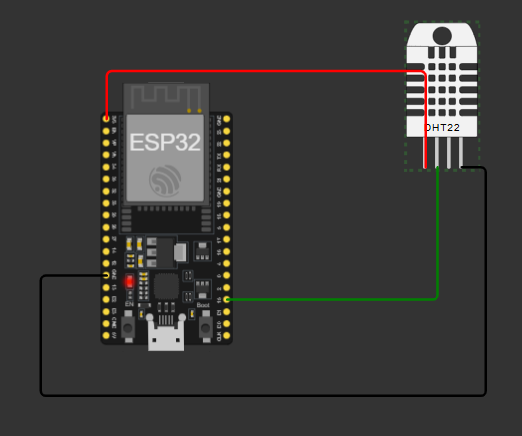
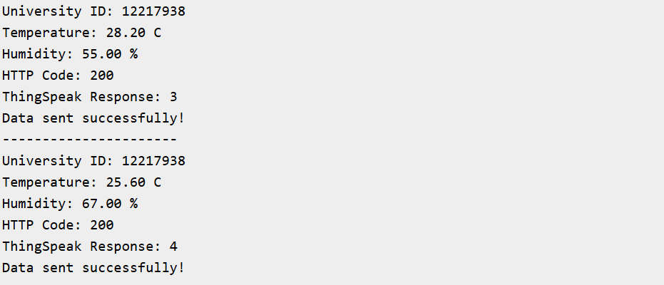
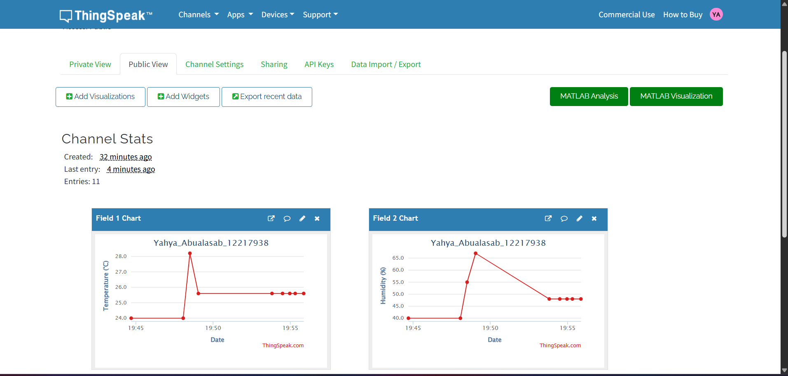

# ESP32 → ThingSpeak IoT Lab

## Student Information

- **Name:** Yahya Abu Alasab
- **University ID:** 12217938
- **University:** An-Najah National University

## Project Description

This project uses an ESP32 and a DHT22 sensor simulated in Wokwi to measure temperature and humidity. The readings are sent to ThingSpeak via Wi-Fi every 20 seconds and displayed on public charts.

The ESP32 connects to the `Wokwi-GUEST` Wi-Fi network and sends temperature to **Field 1 (°C)** and humidity to **Field 2 (%)**. The university ID is printed in the serial monitor log.

## Project Links

- **ThingSpeak Public URL:** [https://thingspeak.mathworks.com/channels/3551792](https://thingspeak.mathworks.com/channels/3551792)
- **Wokwi Simulation:** [https://wokwi.com/projects/478964288849283073](https://wokwi.com/projects/478964288849283073)

## Wiring Connections

| DHT22 | ESP32 |
| ----- | ----- |
| VCC | 3.3V |
| DATA | GPIO 15 |
| GND | GND |

The Wokwi schematic and wiring connections are included in [`diagram.json`](diagram.json).

## Project Files

- [`sketch.ino`](sketch.ino): ESP32 source code.
- [`diagram.json`](diagram.json): Wokwi circuit schematic.
- [`libraries.txt`](libraries.txt): Wokwi library dependencies.
- [`wokwi-project.txt`](wokwi-project.txt): Original Wokwi project link.
- `screenshots/`: Circuit, serial monitor, and ThingSpeak screenshots.

## Screenshots

The screenshots below show the Wokwi circuit, successful serial monitor updates, and the ThingSpeak public charts.

### Wokwi Circuit

### Serial Monitor

### ThingSpeak Temperature & Humidity Graphs

The ThingSpeak screenshot shows the Public View tab with temperature and humidity readings plotted over time.
